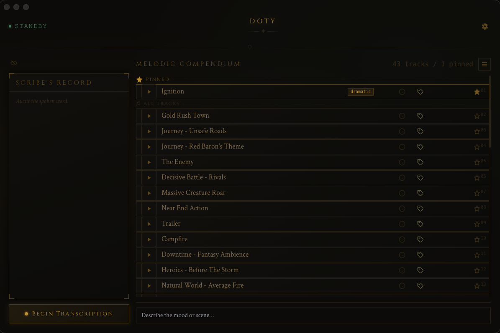

# Doty

AI-powered music companion for tabletop RPG sessions. Doty listens to your table through continuous speech-to-text, then picks the best matching tracks from your music library in real time — no cloud, no API keys, everything runs locally on your machine.

Named after the ever-faithful automaton scribe from Critical Role, Doty sits quietly at your table, listens, and acts.



## The goal

**A DM should never have to touch Doty mid-session.**

Music and sound effects follow the table on their own: a tavern scene gets a
tavern bed, a fight starts when the fight starts, a fireball lands with a
fireball. The score should change at moments that feel composed rather than
corrected, and it should never leave the DM thinking "the music is wrong right
now", reaching for the track list, or waiting for a good moment to switch.

That is not a nice-to-have, it is the product. Everything below is in service of
it, and it is the tiebreaker for every design decision in this repository — see
"Product intent" in [AGENTS.md](AGENTS.md) and
[docs/adr/0001-rank-with-a-decision-model.md](docs/adr/0001-rank-with-a-decision-model.md).
A recommendation nobody acts on, a track that has to be skipped, or a switch the
DM has to time by hand counts as a defect, not a missing feature.

## Features

### Real-time speech-to-text
Doty transcribes your game table continuously using [transcribe.cpp](https://github.com/handy-computer/transcribe.cpp) and GGUF models that run fully offline on Metal. European Portuguese is the default focus (Nemotron 3.5 Streaming, ~0.4 s latency); Parakeet Ultra is available in Settings when accuracy matters more than the typing effect. Transcription quality is gated in CI — see [docs/QUALITY.md](docs/QUALITY.md).

### AI music recommendations
Doty ranks your library with a **decision model** — d1-omni-600M, exported to ONNX and run locally — rather than a text generator. Each pass scores 20 candidate tracks and returns a calibrated probability for every one of them, so "the model is 26% sure" is a real signal that the scene does not fit the library, not a broken score. Candidates are chosen by a cheap keyword/tag/BPM prefilter that deliberately spans calm, mid and loud tracks, because the model can only pick well among what it is offered.

The soundboard shows the top suggestions and, underneath, every option the model ranked, each with its probability. The active mode and its confidence are always visible.

### Automatic sound effects
The soundboard carries a second library of one-shots. With Autopilot on, Doty can fire them from the transcript as well as music — a door, a sword hit, a roar — respecting per-effect and global cooldowns so effects never stack on top of each other.

### Hands-off session
Turn Autopilot on and the session runs itself: music changes when the scene changes, the next track is queued at the boundary rather than swapped mid-scene, and anything you take by hand silences the automation until you explicitly resume it. The decision log records why each choice was or was not made.

### DM scene prompt
Type a scene description like "dark dungeon", "tavern celebration", or "dragon fight" into the prompt bar and Doty immediately re-ranks your library to match. The DM prompt takes priority over the transcript, so you can steer the mood at any time.

### Full music player
- Play, pause, seek, and volume control
- Music queue with drag-to-reorder
- Loop modes: off, single track, or loop queue
- Crossfade with configurable duration (0–5 seconds)
- Pin favourite tracks to the top of the soundboard
- Custom tags on tracks for organization and search
- Browse panel to search and filter your entire library
- Keyboard shortcuts: `N` next track, `P` previous track

### Discord bot integration
Stream your music directly to a Discord voice channel so remote players hear the same soundtrack. Doty connects as a bot, joins your voice channel, and mirrors local playback to Discord in real time with independent volume control.

### Transcript saving
Optionally save session transcripts to a folder of your choice. Transcripts are written automatically as the session progresses.

### Audio analysis
On first scan, Doty analyses every track in your library using essentia.js to extract BPM, key, danceability, and energy. This metadata is stored locally in SQLite and used to improve recommendations.

## Installation

### Download the app

Grab the latest `.dmg` from the [Releases](https://github.com/CodeAndJam/doty/releases) page, open it, and drag Doty to your Applications folder. If macOS refuses to open it, see [Troubleshooting](#troubleshooting).

### Requirements

- macOS (Apple Silicon)
- About 2 GB disk space for the default AI models (larger ASR models need more)

### First launch

1. Open Doty. It downloads the speech model in the background (~740 MB) to `~/.doty/models/`. You can skip onboarding and keep using the app while it downloads.
2. Open Settings (gear icon or `Cmd+,`) and set your **Music folder** — point it at your local music library (mp3, flac, wav, m4a, ogg, aac supported).
3. Doty will scan and analyse your tracks. This takes a few minutes on first run depending on library size.
4. The recommendation reranker downloads automatically on first use and is cached to `~/.doty/hf-cache/`.

## User guide

### Basic workflow

1. Open Settings and select your **music folder** and **microphone**.
2. Click the **Standby** status toggle to start listening.
3. Doty transcribes what it hears and automatically recommends matching tracks in the soundboard.
4. Click any track card to play it — or turn on **Autopilot** and skip this step entirely.
5. Type a scene description in the **prompt bar** above the soundboard to manually steer recommendations.

### Settings

Open with the gear icon (top right) or `Cmd+,`.

| Setting | Description |
|---|---|
| Listening Device | Microphone used for transcription |
| Sound Conduit | Audio output device for playback |
| Music Archive | Folder containing your music files |
| Transcript Vault | Folder where session transcripts are saved |
| Recommendations | Number of tracks to suggest per query (1–20) |
| Crossfade | Fade duration between tracks (0–5 seconds) |

### Soundboard

The soundboard shows two sections:

- **Pinned** — your favourite tracks, always at the top. Click the pin icon on any track to pin/unpin it. Reorder pinned tracks with the arrow buttons.
- **Suggestions** — AI-recommended tracks based on the current transcript and/or DM prompt.

Use the browse button to search the rest of your library. On any track card, **NEXT** inserts it after the current track and **QUEUE** appends it to the end.

### Queue

Click the queue icon in the player bar to open the queue panel. You can:
- Drag tracks to reorder
- Click to jump to any track
- Remove individual tracks
- Clear the entire queue

### Tags

Click the tag area on any track card to add custom tags (e.g. "combat", "tavern", "boss fight"). Tags help you organize and filter tracks in the browse panel. All tags are stored locally.

### Discord streaming

To stream music to a Discord voice channel:

1. **Create a Discord bot** — follow the [Kenku.fm guide](https://www.kenku.fm/docs/getting-a-discord-token) to create a bot application and get a token.
2. **Invite the bot** to your server with `Connect` and `Speak` permissions. In the Discord Developer Portal, go to OAuth2 > URL Generator, select scope `bot`, and check `Connect` + `Speak` under Bot Permissions.
3. **Set the token** in Doty — open Settings, scroll to the Discord section, paste your bot token, and click Connect.
4. **Select a server and voice channel**, then click Join.
5. Play any track in Doty — it will automatically stream to Discord.

The Discord volume slider (visible when in a voice channel) is independent from your local playback volume.

## Troubleshooting

### macOS says "Doty is damaged and can't be opened"

This appears when the downloaded bundle has no valid code signature (for example the 3.2.1 build). Releases are now ad-hoc signed, which replaces that error with the standard "Apple could not verify" prompt. For older downloads, clear the quarantine flag and open the app again:

```bash
xattr -cr /Applications/Doty.app
```

### macOS won't open the app: Apple could not verify Doty is free of malware

Doty is not signed with an Apple Developer ID, so Gatekeeper blocks the first launch. Clear the quarantine flag and open the app again:

```bash
xattr -dr com.apple.quarantine /Applications/Doty.app
```

Alternatively: right-click (or Control-click) Doty in Applications, choose **Open**, then confirm **Open** in the dialog. macOS remembers the choice for later launches.

### Discord

- "Invalid token" — make sure you copied the Bot token (not the Application ID or Client Secret). Reset the token in the Developer Portal and copy it fresh.
- "Operation was aborted" when joining a channel — the bot lacks permission to join that channel. Add the bot to the channel's permissions with `View Channel`, `Connect`, and `Speak`.
- No audio in Discord — make sure a track is playing locally. Also check the bot's volume in your Discord client (right-click the bot in the voice channel).

## Development

### Prerequisites

- macOS (arm64 or x64)
- Node.js 24+ (see `.nvmrc`)
- pnpm

### Setup

```bash
# Install dependencies and rebuild native addons
pnpm install

# Run in dev mode (hot reload)
pnpm run dev

# Run unit tests
pnpm test

# Run e2e tests (requires a prior build)
pnpm run build && pnpm run test:e2e

# Test coverage
pnpm run test:coverage
```

### Running from a git worktree

Each checkout gets its own database, sessions and Electron settings, so several
instances can run at once. `pnpm dev` in a worktree picks a profile from the
worktree directory automatically; the main checkout keeps `~/.doty`.

```bash
git worktree add ../doty-feature -b feat/feature
cd ../doty-feature && pnpm install && pnpm dev
```

Profiles live in `~/.doty/profiles/<name>/`. Downloaded models stay shared in
`~/.doty/models/`, so a new worktree does not re-download gigabytes. Override
with `DOTY_PROFILE=my-test pnpm dev`; use the same value to reopen a profile.
Two instances must not use the same Discord bot token at the same time.

If the launch fails with `Error: Electron uninstall`, the Electron binary in that
worktree was never downloaded: `node node_modules/electron/install.js` fixes it.

### Native addons

`better-sqlite3` is a native addon rebuilt against Electron's Node.js version automatically via the `postinstall` script. `transcribe-cpp` ships prebuilt libraries (no compile step). If you see a `NODE_MODULE_VERSION` mismatch error:

```bash
pnpm run rebuild
```

### Model files

| Model | Size | Location | Purpose |
|---|---|---|---|
| Nemotron 3.5 / Parakeet Ultra (GGUF) | ~740 MB | `~/.doty/models/` | Speech-to-text |
| mmarco-mMiniLMv2-L12-H384-v1 (ONNX) | downloaded on first use | `~/.doty/hf-cache/` | Track recommendation reranking |

These are downloaded on first use and never committed to the repository.

### Project structure

```
electron/           Electron main process
  main.ts           App entry, IPC handlers, window management
  asr.ts            Speech-to-text orchestration
  transcribe-worker.ts  STT worker (transcribe-cpp streams or 10 s chunks)
  stt-quality/      WER/CER metrics and the live-flush policy (gated in CI)
  discord.ts        Discord bot client (connect, voice, streaming)
  discord-audio.ts  Audio transcoding pipeline (ffmpeg -> Opus)
  database.ts       SQLite database for track metadata and tags
  scanner.ts        Music folder scanner and watcher
  analyzer.ts       Audio feature extraction (essentia.js)
  store.ts          Persistent settings (electron-store)
  preload.ts        Preload script exposing IPC to renderer

src/                React renderer
  App.tsx           App shell (model download gate)
  components/
    MainLayout.tsx  Main screen layout
    Soundboard.tsx  Track list with pinned/suggested/all sections
    PlayerBar.tsx   Playback controls, seek bar, volume
    QueuePanel.tsx  Drag-to-reorder queue
    BrowsePanel.tsx Full library browser with search
    TrackCard.tsx   Individual track row
    Settings.tsx    Configuration modal
    DiscordPanel.tsx Discord connection UI
    Transcript.tsx  Live transcript display
    TagInput.tsx    Tag editor component
  hooks/
    useAudioPlayer.ts  Audio playback engine
    useQueue.ts        Queue state management
    useRecorder.ts     Microphone recording
    useQwen.ts         Recommendation model interface
    useCrossfade.ts    Crossfade settings
```

### Architecture

| Layer | Technology |
|---|---|
| UI | React 18 + Tailwind CSS (Electron renderer) |
| Build | electron-vite 5 + Vite 7 |
| STT | transcribe-cpp (Nemotron / Parakeet Ultra / Parakeet Unified / Voxtral GGUF) |
| Live chunking | energy endpointing + 10 s windows for batch models |
| Punctuation | model-native |
| Recommendations | @huggingface/transformers (mmarco-mMiniLMv2) |
| Audio analysis | essentia.js + ffmpeg-static |
| Database | better-sqlite3 |
| Discord | discord.js + @discordjs/voice + prism-media |
| Process isolation | Electron `utilityProcess` for the scene interpreter, worker thread for STT and analysis |

### Building a DMG

```bash
pnpm run dist
```

Produces a macOS DMG in `dist/`.

### Release process

Releases are fully automated via [release-please](https://github.com/googleapis/release-please):

1. Every merge to `main` is analysed by release-please based on [Conventional Commits](https://www.conventionalcommits.org/).
2. It opens (or updates) a Release PR with a generated `CHANGELOG.md` and version bump.
3. When the Release PR is merged, a GitHub Release and tag are created.
4. The `build-dmg` workflow triggers on the new tag and uploads the macOS DMG as a release asset.

You never manually edit `CHANGELOG.md` or bump versions in `package.json`.

### Contributing

1. Fork the repo and create a branch: `feat/<name>`, `fix/<name>`, or `chore/<name>`.
2. Commit using [Conventional Commits](https://www.conventionalcommits.org/) format (see `AGENTS.md` for details).
3. Keep PRs focused — one logical change per PR.
4. All tests must pass before merging.
5. PR titles must follow Conventional Commits format (used as the squash commit message).

```
feat(soundboard): add keyboard shortcuts for playback
fix(asr): handle empty transcript from sherpa-onnx
chore(deps): bump sherpa-onnx-node to 1.13.0
```

## Privacy

Doty runs entirely on your machine. No audio, transcripts, or music data ever leaves your computer. The only network requests are:
- One-time model downloads on first launch (from Hugging Face and GitHub)
- Discord bot connection (only if you configure it)

## License

[MIT](LICENSE) — Copyright (c) 2026 CodeAndJam
