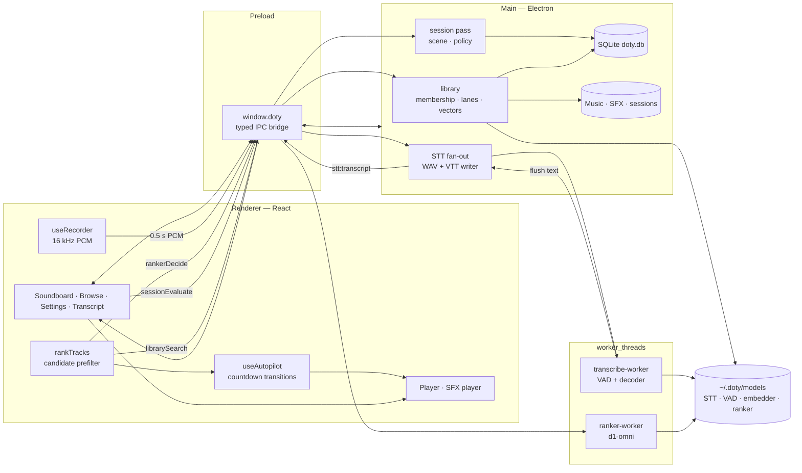
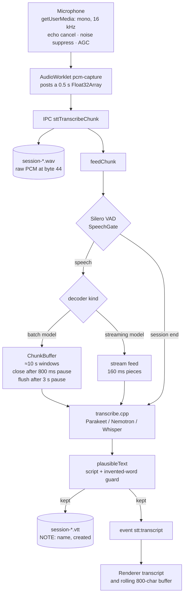
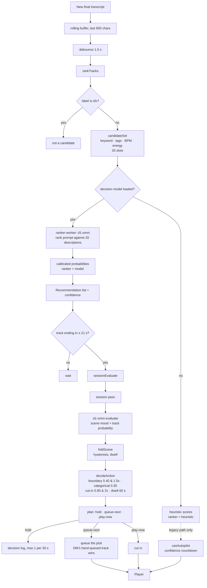
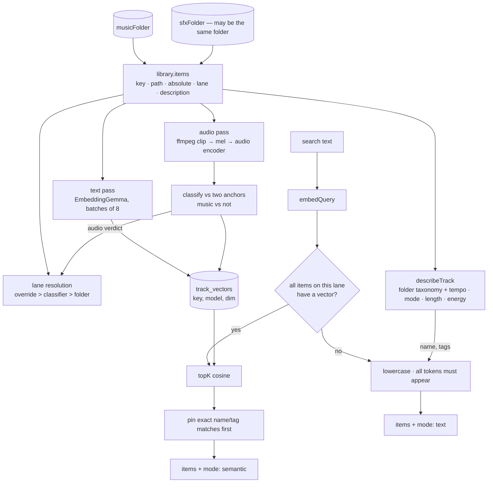
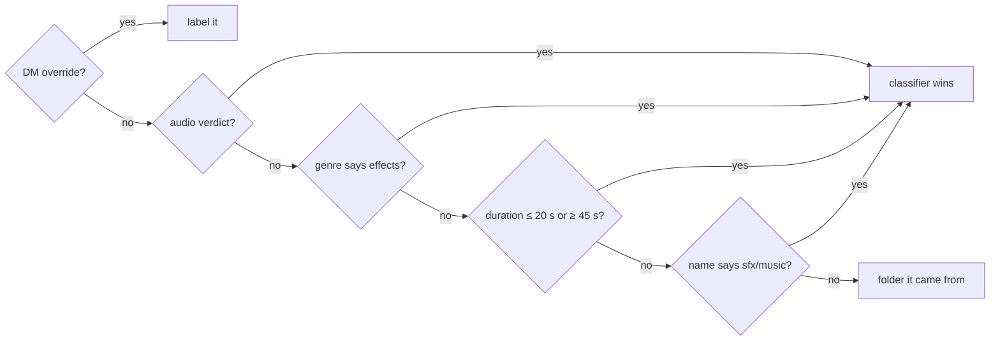
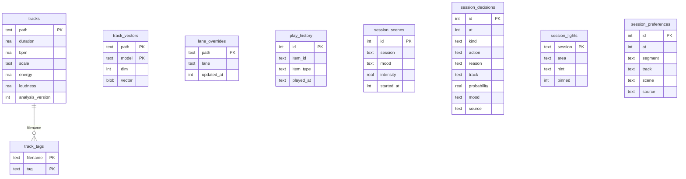
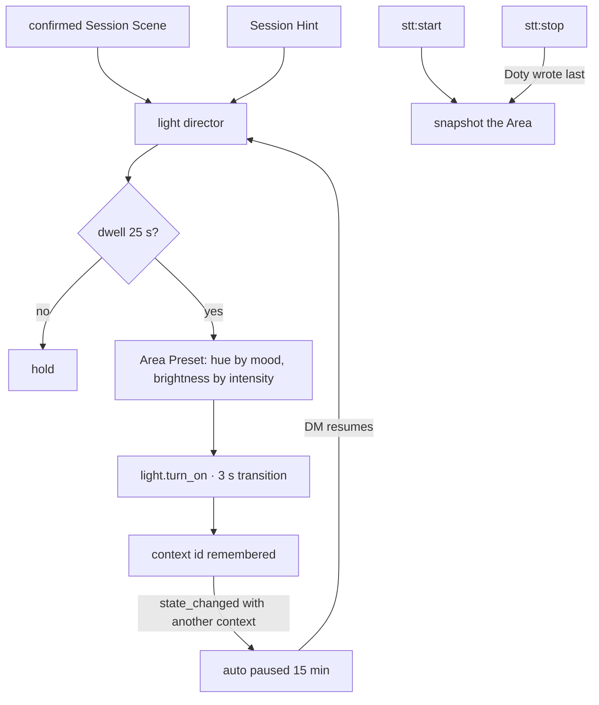

# Architecture

How Doty turns a room full of talking into a soundtrack. Four pipelines, one
process boundary each, and every expensive step either in a worker or behind a
model that can be missing without stopping playback.

Reading order: [process map](#process-map) → [audio to transcript](#audio-to-transcript)
→ [transcript to a music decision](#transcript-to-a-music-decision) →
[library, index and search](#library-index-and-search) → [data](#data) →
[degradation](#degradation).

## Process map

Three processes, one database, and models that are files on disk.

## Audio to transcript

Two copies of the same audio: one is the recording, one is the transcript. They
diverge on purpose — the WAV is the raw room, the transcript is VAD-gated speech.

Why the buffer exists: a batch model handed one VAD phrase at a time has nothing
but its language prior to fill the silence, and it fills it with words nobody
said. Seen on a real session: “Resurrê? O presužma”, “Gareth”. The same audio
decoded as a 15 s window is clean.

### Discord participants

A second capture source, off unless the DM turns it on. `selfDeaf: false` was
already set, so `connection.receiver` delivers each participant's Opus stream;
prism decodes it, ffmpeg resamples 48 kHz stereo to 16 kHz mono, and the whole
speech burst (Discord's 1.2 s silence boundary) is decoded at once by a worker of
its own. Batch-per-utterance is deliberate: one compute in flight per model means
per-speaker streaming needs a model per head, and an utterance decoded whole is
both cheaper and the shape `ChunkBuffer` already proved better than short frames.
Cues are written as WebVTT voice spans (`<v Ana>…</v>`), so one session file stays
valid for any player, and `loadSessionAsync` reads the tag back into a speaker.
The lane's audio is written beside the mic's take as `session-…-remote.wav`,
opened on the first remote utterance so a mic-only session leaves no empty file.
The same cues can be mirrored into the channel's own text chat: lines are
batched for two seconds and packed into as few messages as Discord's 2000-char
limit allows, because a channel rate limit turns one line per message into spam.

## Transcript to a music decision

Two authorities, by design, and only one of them runs at a time.

The split matters: the model path is planned by the **session pass** (main), so
the rules cannot drift between processes. `useAutopilot` only takes over when the
decision model is unavailable — two authorities at once would let one replace a
track mid-phrase.

Suggestions never stop. A manual pick is a label recorded in
`session_preferences`; it does not silence the ranker, and it never causes a
mid-track cut.

## Library, index and search

The library is one module. Before it, five call sites each rebuilt “files, then
metadata, then tags, then a describer”, and two disagreed about which folder
counted.

Indexing is one run with two reported phases (`text`, then `audio`), and it
**pauses while the microphone is recording**: the transcript is the critical
path, and the index is minutes of model work. It resumes when recording stops.

Lane resolution, in isolation:

Each pane searches what it lists, and both use the same retrieval index: the music
pane offers the tracks the music list shows (an effect only when no effects folder
is configured to hold it), the effects pane offers everything labelled an effect.
A search box that answers about a different set than the list under it is a bug,
which is what made "air" miss a wind effect the model ranked first.

## Data

`track_vectors.path` is the library key, not a file path: music uses its path
relative to the music folder (unchanged from the first index), effects use
`sfx:<id>`, because effects never enter `tracks` and both folders can hold the
same relative name.

`lane_overrides.path` is that same key. `source` in `session_preferences` is
`manual`, `auto` or `reject`; a skip is a rejection, not a preference.

## Lights

Home Assistant on the LAN, and nothing else (ADR-0004). One WebSocket does the
whole job: the registries answer which lights exist and which Area they sit in,
`state_changed` says when the DM takes the light back, `call_service` writes.
REST is not used — it cannot see Areas.

The panel is absent from the DOM until a token and address are stored. A session
chooses an Area; Doty touches only `light.*` entities there, skipping a group
when every one of its members is in the same Area.

The director is injected with a port, so the pause, the dwell and the restore are
tested without a socket; `home-assistant.ts` is tested against a fake HA that
speaks only the frames the client is allowed to depend on.

## Degradation

Nothing here may stop playback or hide the suggestions.

| Missing | What still works | What the UI says |
|---|---|---|
| Decision model | recommendations are heuristic | ranker status, per-option probabilities absent |
| Embedding model | search by name/tag; recommendations by keywords | `ready: false`, search `mode: 'text'` |
| Index incomplete | text search over the pane's shelf | `text search — index 12/43` |
| Audio verdict | duration, genre and the name decide | badge falls back to that guess |
| VAD model | RMS gate in the STT worker | none; transcript still arrives |
| STT model | no transcript; DM can type a prompt | onboarding / model status |
| Home Assistant | every other feature; the lights pane is absent | Settings says `needs reconnect` |

## IPC surface

| Area | Channels |
|---|---|
| Transcript | `stt:start` · `stt:stop` · `stt:transcribe-chunk` · `stt:transcript` · `stt:interim` · `stt:status` |
| Sessions | `session:create` · `session:list` · `session:load` · `session:rename` · `session:delete` |
| Library | `music:list` · `music:get-all-metadata` · `library:search` · `library:set-lane` · `library:move-track` · `embedding:status` · `embedding:progress` |
| Ranking | `ranker:decide` · `ranker:status` · `session:sfx-rank` |
| Director | `session:evaluate` · `session:decision` · `session:preference` · `session:report` |
| Playback | player, queue and SFX channels in `electron/ipc.ts` |
| Discord capture | `discord:get-capture-state` · `discord:set-capture-mode` · `capture:state` |
| Discord chat | `discord:get-send-transcript` · `discord:set-send-transcript` |
| Lights | `lights:get-state` · `lights:configure` · `lights:clear` · `lights:discover` · `lights:set-area` · `lights:set-auto` · `lights:set-power` · `lights:set-brightness` · `lights:set-mood` · `lights:set-hint` · `lights:resume` · event `lights:state` |

`session:evaluate` is the only channel whose request shape encodes policy
decisions (`musicEnabled`, `confidenceThreshold`); the answer is a plan, not a
command, so the renderer stays the only thing that touches playback.
