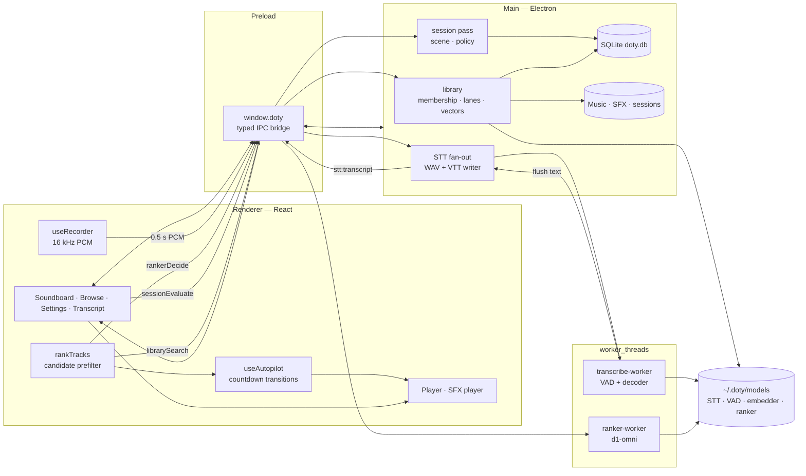
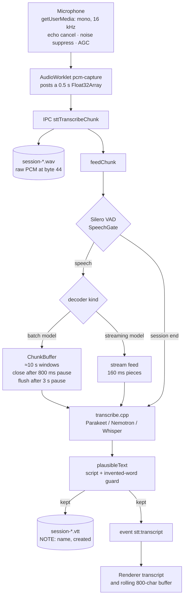
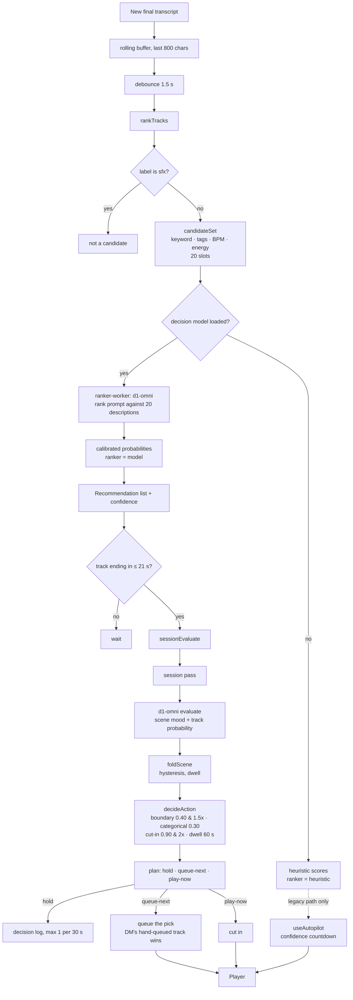
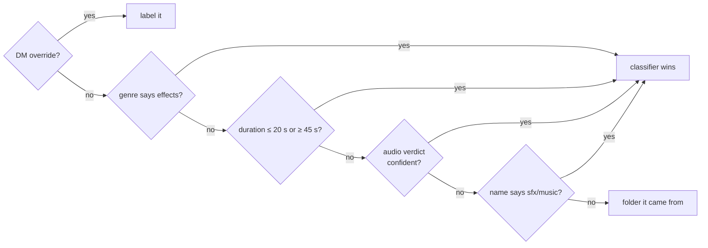
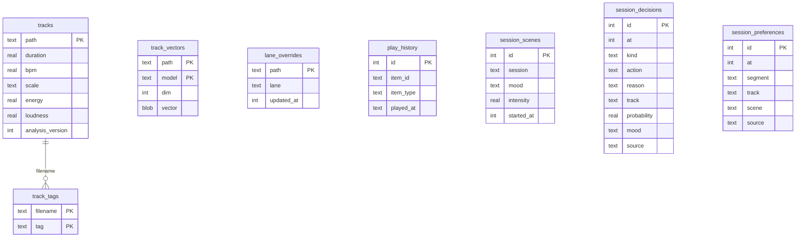

# Architecture

How Doty turns a room full of talking into a soundtrack. Four pipelines, one
process boundary each, and every expensive step either in a worker or behind a
model that can be missing without stopping playback.

Reading order: [process map](#process-map) → [audio to transcript](#audio-to-transcript)
→ [transcript to a music decision](#transcript-to-a-music-decision) →
[library, index and search](#library-index-and-search) → [data](#data) →
[degradation](#degradation).

## Process map

Three processes, one database, and models that are files on disk.

## Audio to transcript

Two copies of the same audio: one is the recording, one is the transcript. They
diverge on purpose — the WAV is the raw room, the transcript is VAD-gated speech.

Why the buffer exists: a batch model handed one VAD phrase at a time has nothing
but its language prior to fill the silence, and it fills it with words nobody
said. Seen on a real session: “Resurrê? O presužma”, “Gareth”. The same audio
decoded as a 15 s window is clean.

## Transcript to a music decision

Two authorities, by design, and only one of them runs at a time.

The split matters: the model path is planned by the **session pass** (main), so
the rules cannot drift between processes. `useAutopilot` only takes over when the
decision model is unavailable — two authorities at once would let one replace a
track mid-phrase.

Suggestions never stop. A manual pick is a label recorded in
`session_preferences`; it does not silence the ranker, and it never causes a
mid-track cut.

## Library, index and search

The library is one module. Before it, five call sites each rebuilt “files, then
metadata, then tags, then a describer”, and two disagreed about which folder
counted.

Indexing is one run with two reported phases (`text`, then `audio`), and it
**pauses while the microphone is recording**: the transcript is the critical
path, and the index is minutes of model work. It resumes when recording stops.

Lane resolution, in isolation:

## Data

`track_vectors.path` is the library key, not a file path: music uses its path
relative to the music folder (unchanged from the first index), effects use
`sfx:<id>`, because effects never enter `tracks` and both folders can hold the
same relative name.

`lane_overrides.path` is that same key. `source` in `session_preferences` is
`manual`, `auto` or `reject`; a skip is a rejection, not a preference.

## Degradation

Nothing here may stop playback or hide the suggestions.

| Missing | What still works | What the UI says |
|---|---|---|
| Decision model | recommendations are heuristic | ranker status, per-option probabilities absent |
| Embedding model | search by name/tag; recommendations by keywords | `ready: false`, search `mode: 'text'` |
| Index incomplete | text search on that lane | `text search — index 12/43` |
| Audio verdict | duration decides | badge falls back to the lane label |
| VAD model | RMS gate in the STT worker | none; transcript still arrives |
| STT model | no transcript; DM can type a prompt | onboarding / model status |

## IPC surface

| Area | Channels |
|---|---|
| Transcript | `stt:start` · `stt:stop` · `stt:transcribe-chunk` · `stt:transcript` · `stt:interim` · `stt:status` |
| Sessions | `session:create` · `session:list` · `session:load` · `session:rename` · `session:delete` |
| Library | `music:list` · `music:get-all-metadata` · `library:search` · `library:set-lane` · `library:move-track` · `embedding:status` · `embedding:progress` |
| Ranking | `ranker:decide` · `ranker:status` · `session:sfx-rank` |
| Director | `session:evaluate` · `session:decision` · `session:preference` · `session:report` |
| Playback | player, queue and SFX channels in `electron/ipc.ts` |

`session:evaluate` is the only channel whose request shape encodes policy
decisions (`musicEnabled`, `confidenceThreshold`); the answer is a plan, not a
command, so the renderer stays the only thing that touches playback.
